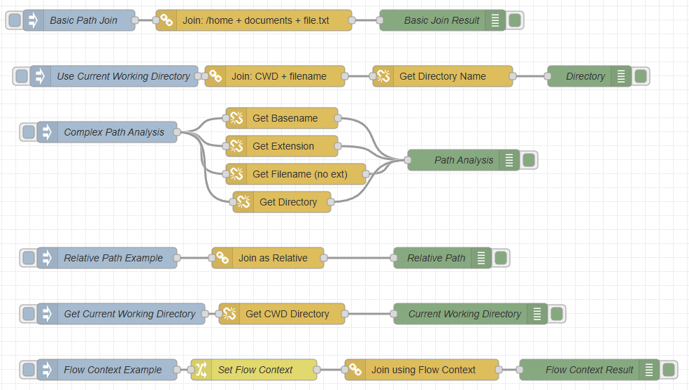

# @background404/node-red-contrib-path-utils

Node-RED nodes for path manipulation using Node.js path module. Combine path segments and extract path information.



## Installation

```bash
npm install @background404/node-red-contrib-path-utils
```

Or install via Node-RED Palette Manager.

## Nodes

### path-join
Joins multiple path segments into a single normalized path.

**Features:**
- Multiple input types (string, msg property, flow/global context, current working directory)
- Output as absolute or relative paths
- Automatic path normalization

### path-get
Extracts information from file paths.

**Features:**
- Multiple input types
- absolute/relative for dirname only

**Extract options:**
- `dirname` - Directory path
- `basename` - Filename with extension  
- `extname` - File extension only
- `filename` - Filename without extension

## Input Types

- `String` - Direct text value
- `Message Property` - Value from msg object
- `Flow Context` - Flow-scoped variable
- `Global Context` - Global variable
- `Current Working Directory` - Node-RED startup directory

## Sample Flows

Example flows are included in the `examples/` folder:
- `basic-example.json` - Simple usage examples
- `comprehensive-example.json` - All features demonstration

Import via Node-RED Menu → Import.
